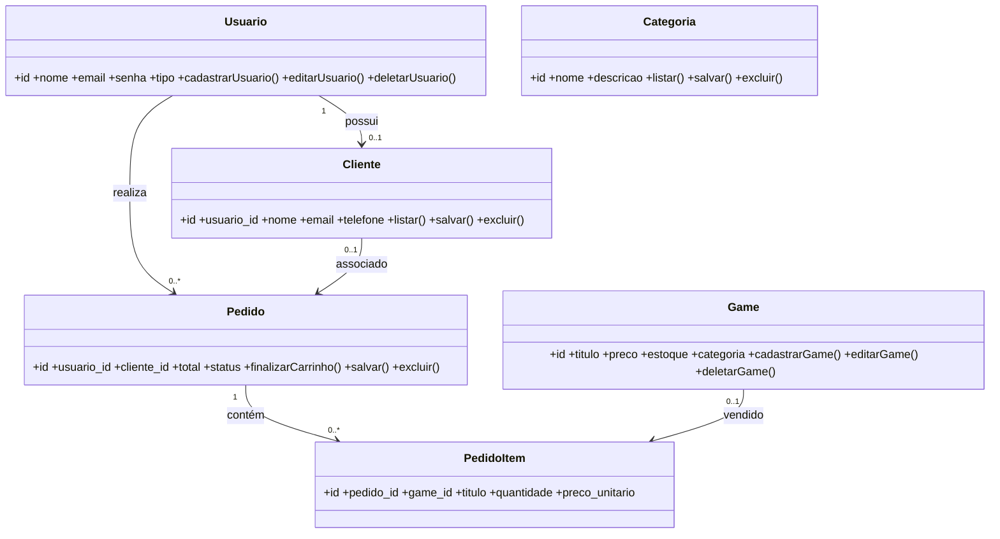

# NextPlay — Loja de Jogos

**Integrantes:** preencher com nomes dos integrantes.  
**Tema:** loja virtual de jogos digitais.  
**Repositório:** inserir URL pública do GitHub após publicar.

## Descrição
Sistema web em PHP 8, MySQL, PDO, orientação a objetos e organização MVC (models, controllers e views na área administrativa). Loja pública com catálogo, busca, filtro por categoria, detalhes, cadastro, autenticação, carrinho e registro de pedidos. Área administrativa com cinco entidades CRUD: usuários, jogos, clientes, categorias e pedidos.

## Tecnologias
PHP 8+, MySQL/MariaDB, PDO, HTML5, CSS3, JavaScript, sessões, `password_hash` e `password_verify`.

## Instalação no XAMPP
1. Copie a pasta `lojagames_next1` para `C:\xampp\htdocs\`.
2. Inicie Apache e MySQL no XAMPP.
3. No phpMyAdmin (`http://localhost/phpmyadmin`), vá à página inicial (sem selecionar outro banco), clique em **Importar** e escolha **`database/nextplay.sql`**.
4. O script cria automaticamente o banco independente `nextplay_db`, todas as tabelas e os dados de teste.
5. A conexão PDO em `admin/config/conexao.php` já aponta para `nextplay_db` (XAMPP: root e senha vazia). Ajuste credenciais se necessário.
6. Abra **`http://localhost/lojagames_next1/index.php`**.
7. Não é necessário importar `loja_games.sql` nem `atualizacao_nextplay.sql` para uma instalação limpa.

**Atenção:** a versão atualizada depende das novas tabelas. Importar o arquivo SQL de atualização é necessário antes de abrir a loja.

## Contas de teste (somente ambiente local)
- Administrador: `evandro@gmail.com` / `admin123`
- Cliente: `pedro@gmail.com` / `user123`

Altere as senhas antes de publicar online. Não publique credenciais de produção.

## Funcionalidades
- Login/logout e sessões com proteção administrativa e token CSRF.
- Senhas com hash; consulta PDO com parâmetros.
- CRUD completo de usuários e jogos (versão original).
- CRUD completo de clientes, categorias e pedidos (novas páginas administrativas).
- Busca de jogos, filtro por categoria, detalhes, upload de imagem (original), carrinho, controle de estoque, painel com indicadores.
- Finalização do carrinho com transação SQL e registro em `pedidos` e `pedido_itens` (não há integração de pagamento real).

## Regras de negócio
- Cadastro público cria usuário comum e registro de cliente vinculado.
- Somente administradores acessam o gerenciamento.
- Um pedido pode conter vários jogos; cada item registra preço e quantidade no momento da compra.
- A compra só é registrada se houver estoque suficiente para todos os itens.
- Exclusão de jogos já vendidos preserva o título e preço histórico dos itens.
- Categoria é mantida como texto no cadastro de jogos para preservar a compatibilidade com o projeto antigo; a tabela `categorias` gerencia as opções de filtro. A associação não é uma FK direta.

## Diagrama de classes (Mermaid)

## Modelo relacional
- `usuarios(id PK, nome, email UNIQUE, senha, tipo)`
- `games(id PK, titulo, descricao, preco, estoque, categoria, imagem)`
- `clientes(id PK, usuario_id FK UNIQUE, nome, email UNIQUE, telefone)`
- `categorias(id PK, nome UNIQUE, descricao)`
- `pedidos(id PK, usuario_id FK, cliente_id FK, total, status)`
- `pedido_itens(id PK, pedido_id FK, game_id FK, titulo, quantidade, preco_unitario)`

## Capturas de tela
Adicionar prints reais após executar: home, catálogo, login, carrinho, painel administrativo e páginas de CRUD.

## Limitações
O projeto mantém o formato legado de rotas PHP e usa MVC principalmente na área administrativa; não é um front controller MVC puro. O status do pedido é administrativo, sem gateway de pagamento. A categoria dos jogos é um campo de texto por compatibilidade com a versão anterior.

## Entrega GitHub

Envie a pasta completa, incluindo `database/nextplay.sql`. O GitHub armazena o script SQL, não executa PHP/MySQL; para testar, o avaliador deve usar XAMPP ou hospedagem PHP com MySQL. Troque as credenciais demonstrativas antes de publicar o sistema na internet.
